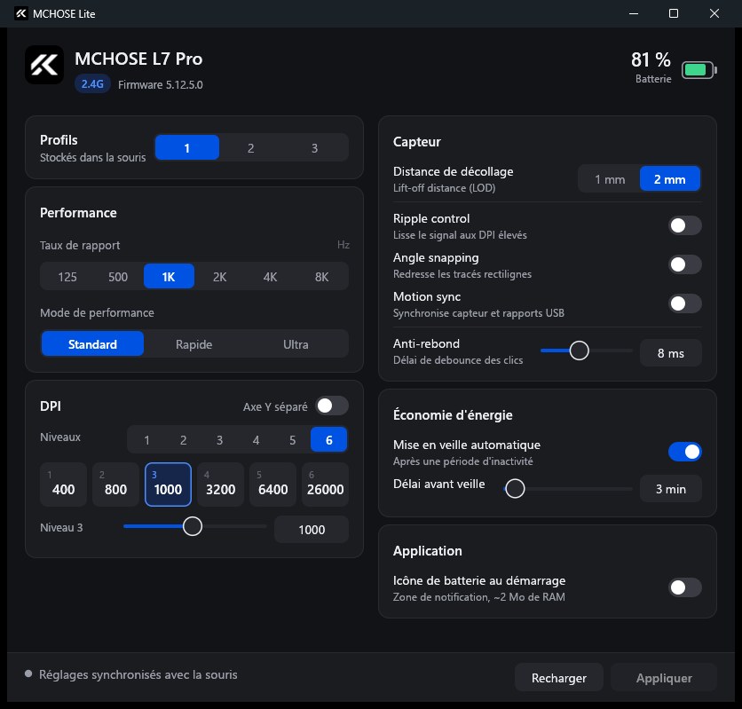
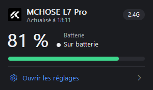

<div align="center">

# MCHOSE Lite

**Un remplaçant léger de MCHOSE HUB pour les souris MCHOSE, écrit en Rust.**

DPI, polling rate jusqu'à 8 kHz, capteur, profils embarqués et batterie dans la zone de
notification, dans **~2 Mo de RAM** au lieu de ~110 Mo.




</div>

## Pourquoi

MCHOSE HUB est une application Electron qui charge son interface depuis Internet et laisse
une dizaine de processus tourner en permanence, alors que tous les réglages de la souris sont
stockés **dans la souris elle-même**. MCHOSE Lite les écrit directement et ne garde en fond
qu'une petite icône de batterie, facultative.

| | MCHOSE HUB | MCHOSE Lite |
|---|---|---|
| En fond | ~110 Mo, ~10 processus | **~2 Mo** (icône de batterie, facultative) |
| Fenêtre ouverte | (inclus ci-dessus) | ~7 Mo (rendu CPU, sans GPU) |
| Connexion Internet | requise pour l'interface | jamais |
| Exécutable | ~100 Mo installés | ~4 Mo, aucune installation |

## Fonctionnalités

- **Performance** : polling rate 125 Hz → 8 kHz (selon le récepteur), mode de performance
  *Standard / Rapide / Ultra*.
- **DPI** : 1 à 6 niveaux, niveau actif, valeurs X/Y séparées en option (jusqu'à 26 000 DPI,
  42 000 sur les modèles Ultra).
- **Capteur** : distance de décollage (LOD 1 / 2 mm), ripple control, angle snapping,
  motion sync, anti-rebond (debounce) des clics.
- **Économie d'énergie** : délai de mise en veille ou veille désactivée.
- **Profils embarqués** 1 à 3, commutables depuis l'app ou en ligne de commande.
- **Seuls les réglages modifiés** sont écrits dans la souris.
- **Souris en veille détectée** : l'app ne propose jamais d'écrire une configuration vide.
- **Éclairage du MagDock** : onglet indépendant avec marche / arrêt, couleur RGB,
  luminosité sur cinq niveaux et effets *Fixe / Respiration / Scintillement /
  Cycle de couleurs / Vague multicolore*. Les effets animés compatibles proposent
  aussi un réglage de vitesse. Le dock reste accessible quand la souris dort.

### Batterie dans la zone de notification



- Icône MCHOSE avec jauge de batterie colorée (grisée si la souris dort).
- Info-bulle « MCHOSE L7 Pro — 82 % ».
- Clic gauche : widget avec niveau, état de charge, connexion et accès aux réglages.
- Clic droit : *Ouvrir les réglages, Actualiser, Lancer au démarrage, Quitter*.
- Alerte unique sous 15 %.
- Batterie relue toutes les 60 s ; la souris n'est ouverte que pendant la lecture.

<br clear="right">

## Matériel pris en charge

| Appareil | USB | État |
|---|---|---|
| MCHOSE L7 Pro (récepteur 8K) | `5253:1020` | testé (firmware 5.12.5.0) |
| MCHOSE K7 Ultra (récepteur 8K) | `5253:1020` | fréquences 125 / 500 / 1 000 / 2 000 / 4 000 / 8 000 Hz écrites et relues (firmware 5.28.5.0) |
| MCHOSE K7 Ultra (filaire / récepteur dédié) | `3837:4150` / `3837:1001` | détection ajoutée d'après le pilote officiel ; matériel non testé dans ces modes |
| MCHOSE MagDock | `3837:1012` | éclairage écrit et relu sur le dock : RGB, cinq effets, luminosité et extinction |
| Autres L7 / A7 / M7 (VID `5253`) | | même protocole, non testé |

La fréquence proposée tient compte du récepteur : le modèle `1021` reste limité à
1 000 Hz. Après un changement de fréquence, l'application relit la configuration et
signale une erreur si la valeur demandée n'a pas été enregistrée. Le Bluetooth ne
permet pas de configurer la souris avec ce protocole.

## Installation

1. Ferme **MCHOSE HUB** et retire-le du démarrage.
2. Récupère `mchose-lite.exe` (voir [Compilation](#compilation)) et place-le où tu veux.
3. Lance-le pour régler la souris. Active *Icône de batterie au démarrage* si tu veux la
   batterie dans la barre des tâches.

> Windows 11 range les nouvelles icônes dans le menu `^` de la barre des tâches :
> fais-la glisser dans la barre pour la garder visible.

## Éclairage du dock

Pour changer l'éclairage, ouvre l'onglet **Dock**, choisis l'effet et les réglages,
puis clique sur **Appliquer**. *Fixe* et *Respiration* permettent de choisir une
couleur personnalisée ; les autres effets gèrent leurs couleurs automatiquement.
Le bouton **Recharger** relit les réglages et retrouve un dock reconnecté. Les
changements ne sont annoncés comme enregistrés qu'après confirmation par le dock.

## Utilisation en ligne de commande

```text
mchose-lite              ouvre la fenêtre de réglages
mchose-lite tray         icône de batterie (relancer ouvre le widget)
mchose-lite status       batterie, firmware et réglages actuels
mchose-lite profile N    active le profil embarqué N (1-3)
```

```text
> mchose-lite status
MCHOSE L7 Pro (2.4G)  firmware 5.12.5.0
batterie   : 82%
profil     : 1
DPI        : 400 800 [1000] 3200 6400 26000
polling    : 1000 Hz
LOD        : 2 mm
debounce   : 8 ms
veille     : 3 min
```

## Compilation

Prérequis : [Rust](https://rustup.rs) avec la toolchain **MSVC** (Visual Studio Build Tools).

```powershell
git clone https://github.com/Brokeos/mchose-lite
cd mchose-lite
cargo build --release
# → target\release\mchose-lite.exe
```

## Protocole

Le protocole a été reconstitué à partir du driver web officiel, puis vérifié sur le matériel :

- feature reports `0x11` (20 octets) et `0x12` (64 octets) sur la collection HID vendeur
  `usage page 0xFF01` ;
- tous les octets après l'identifiant de report sont inversés (`XOR 0xFF`) ;
- chaque commande est acquittée par un input report `0x13` : `E5 <commande>` ;
- `0x12 0x67` lit le profil actif, `0x12 0x40` écrit les DPI, `0x11 0x41` le polling rate,
  `0x11 0x42` le capteur, `0x11 0x43` l'anti-rebond, `0x11 0x0A` la veille,
  `0x11 0x58` le profil, `0x11 0x06` la batterie.

Le détail est dans [`src/protocol.rs`](src/protocol.rs). La correction du décodage
USB / 2.4G et la vérification sur K7 Ultra sont documentées dans
[`docs/k7-ultra-protocol.md`](docs/k7-ultra-protocol.md).
Le protocole distinct du dock est décrit dans
[`docs/magdock-protocol.md`](docs/magdock-protocol.md) et implémenté dans
[`src/dock.rs`](src/dock.rs).

### Vérification

```powershell
cargo test
cargo clippy --all-targets
```

Le test matériel est désactivé par défaut. Avec une **K7 Ultra éveillée**, il parcourt
les fréquences disponibles, vérifie leur relecture et la conservation des autres
réglages, puis restaure la fréquence initiale :

```powershell
cargo test hardware_k7_ultra_polling_rates -- --ignored --nocapture --test-threads=1
```

Avec un **MagDock branché**, le test ci-dessous vérifie l'éclairage puis restaure
ses valeurs initiales. Il peut brièvement changer les couleurs du dock :

```powershell
cargo test hardware_magdock_lighting -- --ignored --nocapture --test-threads=1
```

## Limites

- Pas de remappage des boutons ni de macros.
- Éclairage pris en charge uniquement sur le MagDock `3837:1012` ; pas de
  synchronisation musicale ni de flux audio.
- Pas de mise à jour de firmware : utilise l'outil officiel pour ça.
- Windows uniquement.

## Mentions légales

Projet indépendant, non affilié à MCHOSE (迈从科技). Les marques et l'icône de l'application restent
la propriété de leurs titulaires ; le protocole a été documenté à des fins d'interopérabilité.
**Ayants droit : pour toute demande de retrait (icône, marque, documentation), ouvrez une
issue et l'élément sera retiré rapidement.** Détails dans [LEGAL.md](LEGAL.md).

Logiciel fourni tel quel, sans garantie.

## Licence

[MIT](LICENSE)
